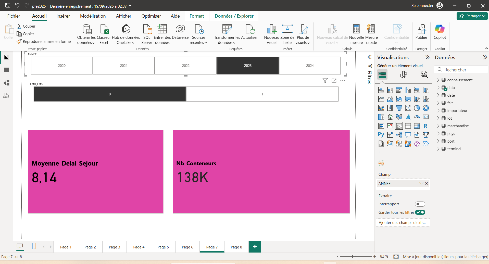
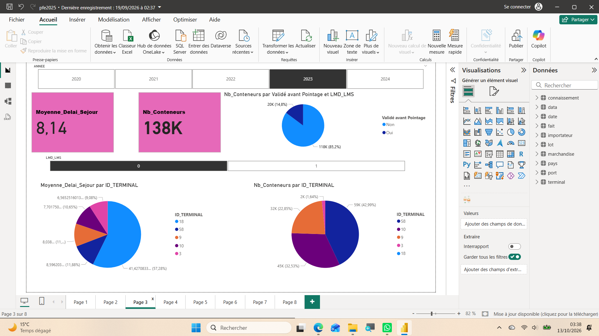
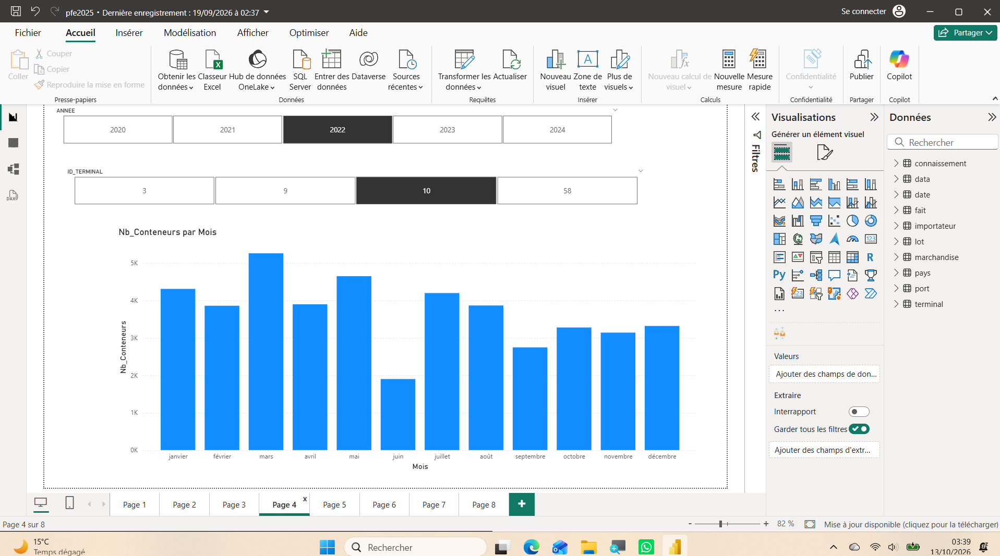
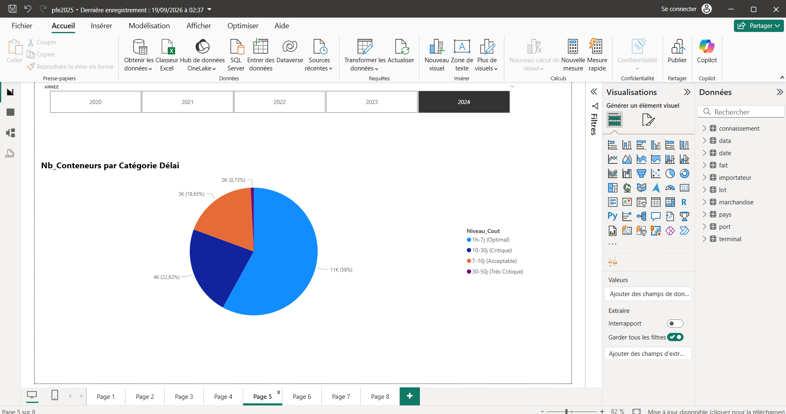
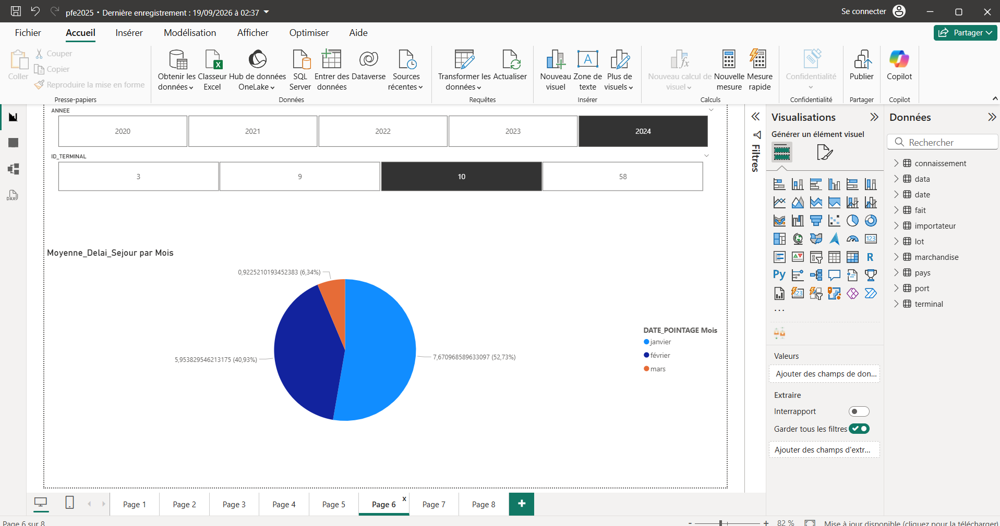
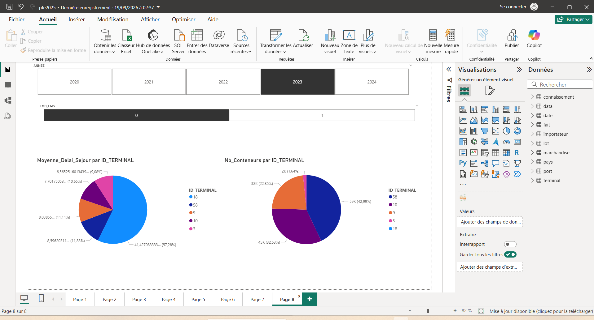

# Port Logistics Dashboard — Power BI

## Project Overview
This dashboard was developed during my final-year internship at PortNet, as part of a project focused on predicting container dwell time.

The Power BI component explores logistics data, tracks key indicators and compares terminal performance.

## My Contribution
- Cleaned and transformed logistics data using Power Query.
- Corrected data types and identified inconsistencies.
- Designed a star-schema data model.
- Created DAX measures and Power BI dashboards to analyze KPIs and terminal performance.
- Documented analytical findings and recommendations in the project report.

## Tools
Power BI · Power Query · DAX · Data Modeling · Data Visualization

## Dashboard Screenshots
The images below provide a static preview of the dashboard.

## Author
Zineb EL HOUATE
